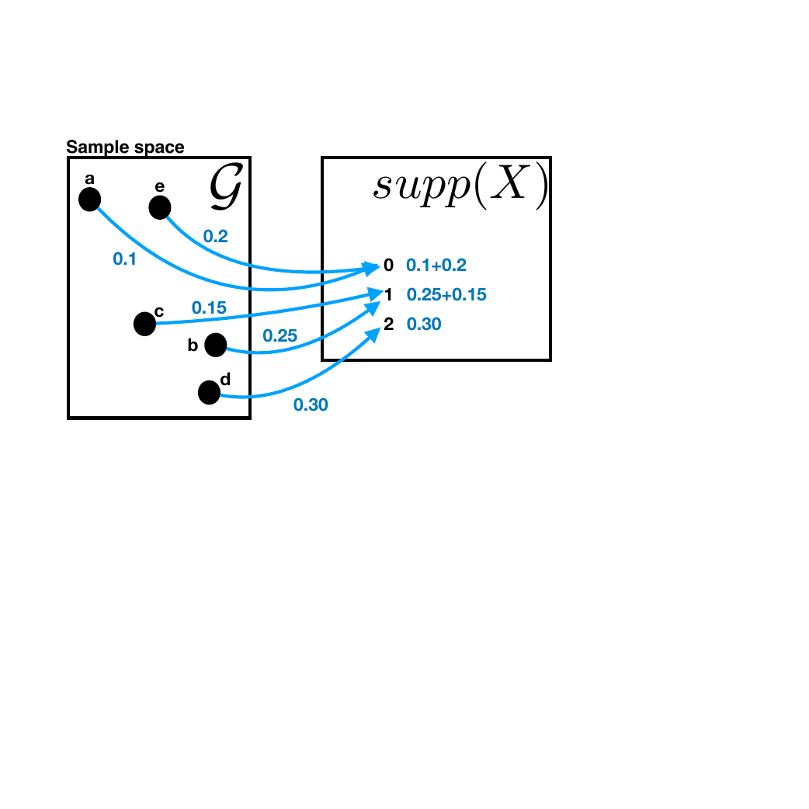

# Random variables

## Introduction
The foundations of probability are built on sets, yet data is more naturally stored and more easily computed on if it is represented numerically.

Random variables match each outcome in our sample space to a value on the number line.

In addition to computational advantages, random variables help us extract from our data the most important characteristics, and they serve as building blocks which we can use to create powerful models. Random variables are also a language we can use to communicate our modeling efforts to other mathematicians, statisticians, and data scientists.

Suppose we hypothesize that the frequency of social media posts on some popular outlet are related to influenza-like illness (ILI)---a syndromic diagnosis suggesting a patient may have influenza. A patient is diagnosed with ILI if their temperature is measured to be at or above 38C and symptoms resembling the flu. Because influenza is most active in winter and spring, we collect a random sample, each day, of social media posts from September to May and in addition we collect the proportion of patients who are admitted to the hospital and are diagnosed with influenza-like illness at the US national level.

The above hypothesis, data collection, and future inference has numerous details. However, we will see shortly that we can simplify our hypothesis by using random variables.

## Maps from the sample space to the number line
Given a sample space $\mathcal{G}$, a **random variable**, (e.g. $X$), is a function from each element in $\mathcal{G}$---from each outcome---to a value on the real number line. The real number line contains all numbers: integer and decimal, from negative to positive infinity.

**Example:** Suppose our sample space contains two elements $\mathcal{G} = \{ a,b \}$. We may decide to define a random variable $X$ that maps the outcome $a$ to the value $-1$ and the outcome $b$ to the value $1$. In otherwords, $X(a)=-1$ and $X(b)=1$. We could as well define a random variable $Y$ on the same sample space such that $Y(a)=0$ and $Y(b)=1$.

**Example:** Suppose our sample space contains all integers from 0 to 1000 $\mathcal{G} = \{0,1,2,3\cdots,1000 \}$. We may be most interested in when an integer is even or odd, and so we can define a random variable $Y(y)=0$ when $y$, our outcome, is an odd integer and $Y(y)=1$ when $y$ is even. This is an example of how a random variable can distill down a sample space with many outcomes into a random variable with two.

**Example:** Suppose we decide to study the relationship between the cumulative total number of cigarettes smoked by a person form the date that they started smoking and the presence of lung cancer. We define our sample space to be $\mathcal{G} = \{ (x,y) | x \in \mathbb{Z}, y \in \{0,1\} \}$. We define two random variables, a random variable $X$ that maps the outcome $(x,y)$ to the value in the first position $x$, and a random variable $Y$ that maps the $outcome (x,y)$ to the value in the second position $y$. Though our outcomes are linked, we can use random variables to think about two separate outcomes---cigarettes smoked and lung cancer---and how they interact.

## A new sample space
When we build a random variable $(X)$ that maps outcomes to values on the number line we create a new sample space which we will call the support of $X$ or $supp(X)$. Define a sample space $\mathcal{G}$ without outcomes $o_{i}$. Then the **support of X** is $$\begin{aligned}
    supp(X) = \{x | X(o) = x  for some outcome  o  in  \mathcal{G} \}
\end{aligned}$$ Our new sample space is the set of all the potential values that our random variable $X$ can produce. This is a sample space linked to $\mathcal{G}$, but in practice after we develop a random variable we often no longer reference $\mathcal{G}$.

In our above example where $\mathcal{G} = \{a,b\}$, the random variable $X$ has support $supp(X) = \{-1,1\}$ and $supp(Y)=\{0,1\}$. Lets look at another example, when above $\mathcal{G}$ is the set of all integers from 0 to 1000. Even though the sample space is quite large, the random variable that maps the integers to 0 when they are odd and 1 when even has a small support $(supp(Y) = \{0,1\})$.

## How to assign probabilities to a random variable
Random variable themselves do not require that we include the probability of each of their values. Random variables are a function from outcomes to the real numbers---nothing more. That said, in practice we build random variables expecting that the probabilities we assign to outcomes in our sample space will correspond to probabilities assigned to values of our random variable.

We assign a probability to the value $x$, which belongs in the support of random variable $X$, the sum of the probabilities of all the outcomes that $X$ maps to $x$. $$P(X=x) = P(o_{1}) + P(o_{2}) + \cdots + P(o_{n})$$ where each outcome $o_{1},o_{2},\cdots,o_{n}$ is mapped by $X$ to the value $x$. In other words, $X(o)=x$ for each of $o_{1},o_{2},\cdots,o_{n}$.

Define a $\Omega = \{a,b,c,d,e\}$ and a random variable $X$ that maps the outcomes to the following values

   Outcome   P(outcome)   X(outcome)
  --------- ------------ ------------
      a         0.1           0
      b         0.25          1
      c         0.15          1
      d         0.3           2
      e         0.2           0

We assign the probability that $X=0$ as the sum of the probabilities assigned to outcome $a$ and outcome $e$, or $$\begin{aligned}
    P(X=0) &= P(\{a\}) + P(\{e\})\\
           &= 0.1+0.2 = 0.3
\end{aligned}$$ We can run the same procedure for all the elements in the support of $X$, $$\begin{aligned}
    P(X=1) &= P(\{b\}) + P(\{c\})\\
           &= 0.25+0.15 = 0.40\\
    P(X=2) &= P(\{d\}) = 0.3 = 0.30,
\end{aligned}$$ and organize our work in a table

   X   P(X=x)
  --- --------
   0    0.30
   1    0.40
   2    0.30

A **probability distribution** for a random variable $X$ is a set of tuples where the first position in each tuple is a value in the support of $X$ and the second position in the tuple is the corresponding probability assigned to that value.

A probability distribution for the random variable $X$ above is $\{(0,0.30),(1,0.40),(2,0.30)\}$.

Imagine we run an experiment that collects data on marathon runners. We decide to collect the number of elapsed minutes until they finish the race. Our sample space is defined as all positive integers $\Omega = \{1,2,3,\cdots,\}$. We may decide to build a random variable $X$ that maps outcomes less than 60 to the value 1, outcomes from 61 to 120 to the value 2, and outcomes greater than 120 to the value 3. One potential probability distribution for $X$ is $\{(1,0.10),(2,0.50),(3,0.40)\}$. For this probability distribution, $P(X=1) = 0.10$, $P(X=2) = 0.50$, and $P(X=3) = 0.40$.

<figure>

<figcaption>A sample space <em>Ω</em> with elements {<em>a</em>, <em>b</em>, <em>c</em>, <em>d</em>, <em>e</em>} and a random variable <em>X</em> that maps each element in <em>Ω</em> to one the values: 0, 1, or 2. Probabilities corresponding to outcomes in the sample space and how they map to probabilities for each value of <em>X</em> are shown in blue.</figcaption>
</figure>

## Probability mass function
There are several supportive tools that we can use to help us better understand random variable we create. The first is the probability mass function, or p.m.f. The **probability mass function** is a [function]{.underline} that maps values in the support of a random variable $X$ to their corresponding probabilities. Inputs are values of $X$, outputs are probabilities.

The probability mass function is a convenient way to organize a probability distribution and it allows us to transfer all the information we know about functions to random variables.

Define a random variable $Y$ with support $\{-1,0,1\}$, probability distribution {(-1,0.2),(0,0.5),(1,0.3)}, and probability mass function $$f(y) = \begin{cases}
            0.2 &  when  y=-1\\
            0.5 &  when  y = 0\\
            0.3 &  when  y=1
            \end{cases}$$ The function---our probability mass function---is a type of function called a **piecewise** function.

We can ask our pm.f. to return the probability for a given value $$f(1) = 0.3$$ and we can visualize our probability mass function using, for example, a barplot.

![A barplot for visualizing the probability mass function of our random variable $Y$. The support of $Y$ is plotted on the horizontal axis and height of each bar corresponds to the probability assigned to that value in the support.[]{#fig.pmfviz label="fig.pmfviz"}](../figures/chapter2/pmfviz.png){#fig-pmfviz}

**Distributed as $f$:** Because we can use the probability mass function to describe the probability distribution of a random variable, we will often write $$Y \sim f$$ The above formula is read \"the random variable $Y$ is distributed as $f$\", and what we mean when a random variable is distributed as $f$ is that the support of $Y$ is the same as the domain of the function $f$ and that the probability of a value $y$ is equal to $f(y)$, or $$\begin{aligned}
    supp(Y) &= dom(f)\\
    P(Y = y) &= f(y)
\end{aligned}$$

The probability mass function is a convenient method for assigning probabilities to random variables and visualizing the distribution of a random variable.

## Cumulative mass function
The **cumulative mass function** is a [function]{.underline} that maps values in the support of a random variable $X$ to the probability that the random variable is less than or equal to this value, or $P(X \leq x)$.

We use a capital $F$ to denote a cumulative mass function (c.m.f). The c.m.f. corresponding to random variable $X$ has a domain equal to the support of $X$ and produces values between 0 and 1 (the values a function can produce is called the function's **image**).

$$\begin{aligned}
    supp(X) &= dom(F)\\
    image(F) &= [0,1]\\
    P(X \leq x) &= F(x)
\end{aligned}$$

The c.m.f. too can be visualized and we could also use the c.m.f. to describe the probability distribution of a random variable. This is because we can use the c.m.f. to derive the p.m.f.

![A barplot for visualizing the cumulative mass function of our random variable $Y$. The support of $Y$ is plotted on the horizontal axis and height of each bar corresponds to the probability assigned to values $(v)$ less than or equal to $v$ in the support.[]{#fig.pmfviz label="fig.pmfviz"}](../figures/chapter2/cmfviz.png){#fig-pmfviz}

For a random variable $$\begin{aligned}
    X &\sim f\\
    supp(X) &= \{0,1,2,3\}\\
    f(x) &= \begin{cases}
     0 & 0.1\\
     1 & 0.3\\
     2 & 0.2\\
     3 & 0.4\\
    \end{cases}
\end{aligned}$$ The c.m.f is then $$\begin{aligned}
    F(x) =  
    \begin{cases}
     0 & 0.1\\
     1 & 0.3 + 0.1 = 0.4\\
     2 & 0.2+0.3+0.1 = 0.6\\
     3 & 0.4+0.2+0.3+0.1 = 1\\
     \end{cases}
\end{aligned}$$

We can use the c.m.f $(F(x))$ to compute any p.m.f ($f(x)$) too by noticing that for a support $\{x_{0},x_{1},x_{2},x_{3}, \cdots,x_{n-1}\cdots,x_{n}\}$ where the values in this set are ordered form smallest to largest $$\begin{aligned}
    f(x_{i}) &= \left[f(x_{i}) + f(x_{i-1}) + \cdots f(x_{0}) \right] - \left[f(x_{i-1}) + \cdots f(x_{0})\right] \\ 
    &=F(x_{i}) - F(x_{i-1}).
\end{aligned}$$ Because the p.d.f. and c.m.f equivalently describe the probability distribution of a random variable we can write $X\sim F$ or $X \sim f$.

## Two or more random variables
A single random variable is a useful way to describe a sample space and the probabilities assigned to values on the number line corresponding to outcomes.

But more complicated scientific questions often require several random variables and rules for how they interact. We will explore how to generate multiple random variables on the same sample space. Then we will develop an approach to define probabilities for combinations of random variables, a joint probability mass function and joint cumulative mass function.

Suppose we design a sample space $\Omega$ and build two random variables on this space $X$ and $Y$. Because $X$ and $Y$ are random variables we can think of the support of $X$ and support of $Y$ as two new sample spaces. Lets assume that the outcomes in $supp(X) = \{x_{1},x_{2},x_{3},\cdots,x_{N}\}$ and that the outcomes in $supp(Y) = \{y_{1},y_{2},\cdots,y_{M}\}$. Then we can define a new set of outcomes in the space $supp(X) \times supp(Y) = \{x_{i}, y_{j}\}$ for all combinations of $i$ from $1$ to $N$ and $j$ from $1$ to $M$.

This new space above maps outcomes in $\Omega$ to a tuple $(x_{i},y_{j})$ where the outcomes were mapped by $X$ to the value $x_{i}$ and by $Y$ to the value $y_{j}$. If we assign the probability of $(x_{i},y_{j})$ to be the the sum of the probabilities of all outcomes in $\Omega$ that $X$ maps to $x_{i}$ and $Y$ maps to $y_{i}$ then we call this a **joint probability distribution**.

A pharmaceutical company launches a clinical trial to study adverse events from a novel medicine. The trial enrolls patients and randomizes them to receive the novel drug or optimal medical therapy. The trial expects three potential adverse events which we call $ae_{1}$, $ae_{2}$, and $ae_{3}$. We may choose to define a sample space $\Omega = \{(nov,ae_{1}),(nov,ae_{2}),(nov,ae_{3}),(omt,ae_{1}),(omt,ae_{2}),(omt,ae_{3})\}$ and further build a random variable $X$ that maps outcomes to values 0 when an adverse event was experienced by a control patient and 1 when an adverse event was experienced by a novel drug patient, and a random variable $Y$ that maps adverse event 1 to the value 1, adverse event 2 to the value 2, and adverse event 3 to the value 3. $$\begin{aligned}
    \Omega = \{(nov,ae_{1}),(nov,ae_{2}),(nov,ae_{3}),(omt,ae_{1}),(omt,ae_{2}),(omt,ae_{3})\}
\end{aligned}$$

       Event        X
  ---------------- ---
   $(nov,ae_{1})$   1
   $(nov,ae_{2})$   1
   $(nov,ae_{3})$   1
   $(omt,ae_{1})$   0
   $(omt,ae_{2})$   0
   $(omt,ae_{3})$   0

       Event        Y
  ---------------- ---
   $(nov,ae_{1})$   1
   $(nov,ae_{2})$   2
   $(nov,ae_{3})$   3
   $(omt,ae_{1})$   1
   $(omt,ae_{2})$   2
   $(omt,ae_{3})$   3

A joint probability distribution would assign probabilities to all possible pairs of values for $X$ and $Y$.

   X   Y   prob
  --- --- ------
   1   1   0.1
   1   2   0.05
   1   3   0.23
   0   1   0.05
   0   2   0.30
   0   3   0.27

We write $P(X=x, Y=y)$ to denote the probability assigned to the joint probability that the random variable $X$ equals the value $x$ and the random variable $Y$ equals the value $y$. With the above example in mind, $P(X=0,Y=2) = 0.30$ and this probability could be described as the probability an OMT patient experiences adverse event 2.

Joint probability distributions are often visualized as a table with one random variable's values representing the rows and the second random variable's values representing the columns

         Y = 1   Y = 2   Y = 3
  ----- ------- ------- -------
   X=0   0.05    0.30    0.27
   X=1   0.10    0.05    0.23

A joint distribution can be used to compute probabilities that the random variable $X$ equals the value $x$ for any value of $Y$---$P(X=x)$ and also the probability that the random variable $Y$ equals the value $y$ for any value of $x$---$P(Y=y)$. These probabilities are called **marginal probabilities**.

The marginal probabilities that $X$ equals $0$, or $P(X=0)$, is computed by summing the joint probabilities where $X=0$. We can use the same procedure to compute the marignal probability that $X=1$.

$$\begin{aligned}
    P(X=0) &= P(X=0,Y=1) + P(X=0,Y=2) + P(X=0,Y=3)\\
           &= 0.05+0.30+0.27 = 0.62\\
    P(X=1) &= P(X=1,Y=1) + P(X=1,Y=2) + P(X=1,Y=3) \\
           &= 0.10+0.05+0.23 = 0.38 \\
\end{aligned}$$

The same procedure can be done for the random variable $Y$ to find marginal probabilities:

$$\begin{aligned}
    P(Y=1) &= P(X=0,Y=1) + P(X=1,Y=1)\\
           &= 0.1+0.05 = 0.15 \\
    P(Y=2) &= P(X=0,Y=2) + P(X=1,Y=2)  \\
           &= 0.05+0.30 = 0.35 \\
    P(Y=3) &= P(X=0,Y=3) + P(X=1,Y=3)  \\
           &= 0.23+0.27 = 0.50\\
\end{aligned}$$

Joint distributions need not be restricted to only two random variables. We can build joint distributions of any number of random variables and can compute marginal probabilities in the same way that we do for a joint distribution of two random variables.

The rules, laws, and theorems of probability that we learned in chapter one carry over to random variables. This is because we can consider a new sample space of values that our random variable can take. Suppose we build two random variables $X$ that maps outcomes to the the values -1,0,1 and $Y$ that maps outcomes to the values 1,2,3. We can define a new sample space $\Omega = \{(x,y) | x \in supp(X)  and  y \in supp(Y) \}$ With our new sample space, we can now discuss statements like $P(X = x | Y = y)$.

If we continue with our pharmaceutical example, we can build a new sample space $\Omega = \{(0,1),(0,2),(0,3),(1,1),(1,2),(1,3)\}$ and compute, for example, $P(X=1 | Y=2) = \frac{P(X=1,Y=2)}{P(Y=2)} = \frac{0.05}{0.35} = 0.14$.

We can define the conditional probability of the value of one random variable given another as $$\begin{aligned}
    P(A =a | B =b) = \frac{P(A=a,B=b)}{P(B=b)}
\end{aligned}$$

and so define statistical independence between two random variables, $A$ and $B$, as $$\begin{aligned}
    P(A = a | B=b) = P(A = a)  for all  a \in supp(A),b \in supp(B)    
\end{aligned}$$

We can also translate the law of total probability from events to random variables. For a partition $[Y=y_{1}] \cup [Y=y_{2}] \cup [Y=y_{3}] \cup \cdots \cup [Y=y_{n}]$ of the event that the random variable $X=x$, $$\begin{aligned}
    \begin{aligned}
    P(X=x) = P(X=x|Y=y_{1})p(y_{1}) + P(X=x|Y=y_{2})p(y_{2})\\ + P(X=x|Y=y_{3})p(y_{3}) \cdots + P(X=x|Y=y_{n})p(y_{n})
    \end{aligned}
\end{aligned}$$

By thinking of the values of a random variable as outcomes in a new sample space, we can apply our past intuition and the past mechanics of events, sets to a collection of random variables.

## Functions of a random variable
There are times that we may wish to summarize the behavior of a random variable. One common way to describe how probability is distributed among values in the support of a random variable is by computing some function of that random variable.

### Multiplying and adding a constant to a random variable
Suppose we have defined a random variable $X$ and wish to study a new random variable $Y = g(X)$ that is a function of $X$. The values and the probabilities assigned to $X$, along with the function $g$ will determine the values in the support of $Y$ and assigned probabilities to these values.

#### Translation
Define a random variable $X$ with p.m.f. $f_{X}$ and a new random variable $Y = X+c$ where $c$ is a constant. Then the support for $Y$, $supp(Y) = \{ x+c | x \in supp(X) \}$ and the p.m.f. of $Y$, $f_{Y}(y)$ is $$\begin{aligned}
    f_{Y}(y) &= P(Y=y) \\ 
     &= P(X+c = y)\\ 
     &= P(X=y-c)\\
     &= f_{X}(y-c)
\end{aligned}$$

In otherwords, the probability distribution on $Y$ is $\mathbb{P} = \{ (y,p) \;|\; y=x+c  and  P(X=x) = p \}$. This type of transformation of the random variable $X$ to $Y$ is called a **translation**.

Suppose we define a random variable $Z$ such that $supp(Z) = \{0,1,2,3,4,5\}$ and $$\begin{aligned}
    f_{Z}(z) = \begin{cases}
                0.10 &  if  z=0\\
                0.05 &  if  z=1\\
                0.20 &  if  z=2\\
                0.12 &  if  z=3\\
                0.07 &  if  z=4\\
                0.58 &  if  z=5
               \end{cases}
\end{aligned}$$

We can define a new random variable $Y = Z-4$. This random variable will have $supp(Y) =\{-4,-3,-2,-1,0,1\}$ and

$$\begin{aligned}
    f_{Y}(y) = \begin{cases}
                0.10 &  if  y=-4\\
                0.05 &  if  y=-3\\
                0.20 &  if  y=-2\\
                0.12 &  if  y=-1\\
                0.07 &  if  y=0\\
                0.58 &  if  y=1
               \end{cases}
\end{aligned}$$

#### Scaling
Define a random variable $X$ with p.m.f. $f_{X}$ and a new random variable $Y = c \cdot X$ where $c$ is a constant. Then the support for $Y$, $supp(Y) = \{ c \cdot x | x \in supp(X) \}$ and the p.m.f. of $Y$, $f_{Y}(y)$ is $$\begin{aligned}
    f_{Y}(y) &= P(Y=y) \\ 
     &= P(cX = y)\\ 
     &= P(X=y/c)\\
     &= f_{X}(y/c)
\end{aligned}$$

When we multiply or divide a random variable by a constant to produce a new random variable this is called **scaling**.

Suppose we define a random variable $Z$ such that $supp(Z) = \{0,1,2,3,4,5\}$ and $$\begin{aligned}
    f_{Z}(z) = \begin{cases}
                0.10 &  if  z=0\\
                0.05 &  if  z=1\\
                0.20 &  if  z=2\\
                0.12 &  if  z=3\\
                0.07 &  if  z=4\\
                0.58 &  if  z=5
               \end{cases}
\end{aligned}$$

We can define a new random variable $Y = 4 \cdot Z$. This random variable will have $supp(Y) =\{0,4,8,12,16,20\}$ and

$$\begin{aligned}
    f_{Y}(y) = \begin{cases}
                0.10 &  if  y= 0\\
                0.05 &  if  y= 4\\
                0.20 &  if  y= 8\\
                0.12 &  if  y= 12\\
                0.07 &  if  y= 16\\
                0.58 &  if  y= 20
               \end{cases}
\end{aligned}$$

### General transformation of a discrete random variable
We explored translation and scaling as specific ways to use one random variable to generate another. However, there are many functions we can apply to a random variable $X$ to create a new random variable $Y$, and we need a more general method to compute the probability mass function for $Y$.

Build a random variable $X$ and define $Y$ to be a new random variable such that $Y = g(X)$. Then the support for $Y$ is $supp(Y) = \{y | y = g(x)  and  x \in supp(X) \}$, and $$\begin{aligned}
    f_{Y}(y) = f_{X}(x_{1}) + f_{X}(x_{2}) + \cdots f_{X}(x_{n})  
\end{aligned}$$ where $x_{1},x_{2}, \cdots x_{n} \in g^{-1}(y)$. If $Y$ is a function of $X$ then the probability that the random variable $Y$ will assign to the value $y$ is the sum of the probabilities the random variable $X$ assigns to the set of values $x_{1},x_{2},\cdots,x_{n}$ that are mapped to $y$ by the function $g$.

Let $X$ be the random variable with p.m.f $$\begin{aligned}
    f_{X}(x) = \begin{cases}
                0.01 &  if  x=-2 \\  
                0.05 &  if  x =-1\\
                0.50 &  if  x=0\\
                0.34 &  if  x=1\\
                0.10 &  if  x=2
               \end{cases}
\end{aligned}$$ and also build a new random variable $Y = X^{2}$. Here the function $g$ is $g(x) = x^{2}$. The support of $Y$ is $$\begin{aligned}
    supp(Y) & = \{ -2^{2},-1^{2},0^{2},1^{2},2^{2} \}\\
            & = \{ 4,1,0,1,4 \}\\
            & = \{ 0,1,4 \}
\end{aligned}$$

To compute $P(Y=0)$ we need to sum up the probabilities of all values in $supp(X)$ that $g$ maps to $0$. In our case the only value mapped to $0$ is the value $0$, and so $P(Y=0) = P(X=0) = 0.50$. To compute $P(Y=1)$ we need to sum the probabilities of all values that $g$ maps to the value $1$. In this case two values in $X$ map to $1$, the values $-1$ and $1$, and so $P(Y=1) = P(X=-1) + P(X=1) = 0.05+0.34=0.39$. Finally, $P(Y=4) = P(X=-2) + P(X=2) = 0.11$ (why?). The pm.f for $Y$ is $$\begin{aligned}
    f_{Y}(y) = \begin{cases}
                  0.50 &  if  y=0\\
                  0.39 &  if  y=1\\
                  0.11 &  if  y=4\\
               \end{cases}
\end{aligned}$$

### Expectation
Suppose we build a random variable $X$ with a corresponding probability mass function $f_{X}$.

The **expected value** of a random variable $X$ is computed as $$\begin{aligned}
    \mathbb{E}\left(X \right) &=
    P(X=x_{1})x_{1} +P(X=x_{2})x_{2} + \cdots + P(X=x_{n})x_{n}\\ 
    &= f(x_{1})x_{1} + f(x_{2})x_{2} + \cdots + f(x_{n})x_{n} 
\end{aligned}$$ where $x_{1},x_{2},\cdots,x_{n}$ are all values in the $supp(X)$.

An intuitive definition of the expected value is that $\mathbb{E}(X)$ is a weighted average of all values in the support of $X$ where the weight for $x_{i}$ is the probability of $x_{i}$. The expected value of $X$ will be close to values in $supp(X)$ with high probability.

Build a random variable $Y$ with support $supp(Y) = \{-1,0,1\}$ and $f_{Y} = \{(-1,0.2),(0,0.5),(1,0.3)\}$. The expected value of $Y$ is $\mathbb{E}(Y) = 0.2 (-1) + 0.5 (0) + 0.3 (1) = 0.1$.

#### Properties of the expectation
The expectation is a linear function, that is $\mathbb{E}(aY + b) = a\mathbb{E}(Y) + b$. We can show this by defining a random variable $Z = aY+b$ and asking $$\begin{aligned}
    \mathbb{E}(Z) &= z_{1} f_{Z}(z_{1}) + z_{2} f_{Z}(z_{2}) + \cdots z_{n} f_{Z}(z_{n})\\
                  &=  (ay_{1}+b) f_{Z}(z_{1}) + (ay_{2}+b) f_{Z}(z_{2})+ \cdots (ay_{n}+b) f_{Z}(z_{n})\\
                  & \begin{aligned}
                  &= a \left[ y_{1}f_{Z}(z_{1}) + y_{2}f_{Z}(z_{2}) + \cdots y_{n}f_{Z}(z_{n}) \right] \\
                  &+ b\left[f_{Z}(z_{1}) + f_{Z}(z_{2}) + \cdots + f_{Z}(z_{n}) \right]
                  \end{aligned} \\
                  &= a \left[ y_{1}f_{Z}(z_{1}) + y_{2}f_{Z}(z_{2}) + \cdots y_{n}f_{Z}(z_{n}) \right] + b \hspace{2mm} (why?) \\
                  &= a \left( y_{1}f_{Y}(y_{1}) + y_{2}f_{Y}(y_{2}) + \cdots y_{n}f_{Y}(y_{n}) \right) + b \label{exp.last} \\
                  &= a \mathbb{E}(Y) + b 
\end{aligned}$$

The step [\[exp.last\]](#exp.last){reference-type="eqref" reference="exp.last"} deserves some attention. Values $z_{i}$ are equal to $ay_{i} + b$, they are mapped from the values $y_{i}$ and so the probability that $Z$ equals $z_{i}$ is equivalent to the probability that $Y$ equals $y_{i}$.

### Second moment and variance
Define a random variable $Y$ with $supp(Y) - \{y_{1},y_{2},\cdots,y_{n}\}$, then **variance** is the following function of $Y$ $$\begin{aligned}
    \begin{aligned}
        V(Y) = \left[y_{1} - \mathbb{E}(Y) \right]^{2} P(Y=y_{1}) + \left[y_{2} - \mathbb{E}(Y) \right]^{2} P(Y=y_{2}) +\\ \cdots + \left[y_{n} - \mathbb{E}(Y) \right]^{2} P(Y=y_{n})
    \end{aligned}
\end{aligned}$$

The variance can be thought of as the squared distance of each value in the support of the random variable $Y$ from the expected value weighted by the probability of each value. In some sense, the variance attempts to measure the squared distance from the expected value.

Define a random variable $Z$ with probability mass function $$\begin{aligned}
    f_{Z}(z) = \begin{cases}
                  0.14 &  if  z=0\\
                  0.39 &  if  z=1\\
                  0.21 &  if  z=2\\
                  0.26 &  if  z=4\\
               \end{cases}
\end{aligned}$$ To compute $V(Z)$ we need to first compute the expected value of $Z$ or $\mathbb{E}(Z)$: $$\begin{aligned}
    \mathbb{E}(Z) &= f_{Z}(0) \cdot 0 + f_{Z}(1) \cdot 1 + f_{Z}(2) \cdot 2 + f_{Z}(4) \cdot 4\\
                  &= 0.14 \cdot 0 + 0.39 \cdot 1 + 0.21 \cdot 2 + 0.26 \cdot 4\\
                  &= 1.85 
\end{aligned}$$ Now we can compute the variance $$\begin{aligned}
    &\begin{aligned}
        V(Z) = (0-1.85)^{2} \cdot f_{Z}(0) + (1-1.85)^{2} \cdot f_{Z}(1) +\\
          (2-1.85)^{2} \cdot f_{Z}(2) + (4-1.85)^{2} \cdot f_{Z}(4)
    \end{aligned}\vspace{3mm}\\ 
    &\begin{aligned}
        &=(0-1.85)^{2} \cdot 0.14 + (1-1.85)^{2} \cdot 0.39 +\\
        &(2-1.85)^{2} \cdot 0.21 + (4-1.85)^{2} \cdot 0.26
    \end{aligned}  \vspace{3mm}\\ 
    &= 1.97
\end{aligned}$$

### Just in time summation
Summing a sequence of values is performed so frequently in mathematics and statistics that we have developed a special notation that simplifies sums.

Given a sequences of values, $x_{1}, x_{2}, x_{3}, \cdots, x_{n}$, that we wish to sum define the following operator to represent that sum $$\begin{aligned}
    \sum_{i=1}^{n} x_{i} = x_{1} + x_{2} + \cdots + x_{n}
\end{aligned}$$

### How the expected value earned its name
#### Markov inequality
$$P(X > a) < \frac{ \mathbb{E}(X) }{a}$$

Suppose we define a random variable $X$ with a support that takes only non-negative numbers. $$\begin{aligned}
    \mathbb{E}(X) &= \sum_{ x_{i} \in supp(X)} x_{i} f_{X}(x_{i}) \\ 
    \mathbb{E}(X) &= \sum_{ x_{i} \leq a  } x_{i} f_{X}(x_{i}) + \sum_{ x_{i} > a  } x_{i} f_{X}(x_{i}) \\
    \mathbb{E}(X) &>  \sum_{ x_{i} > a  } x_{i} f_{X}(x_{i}) \\
    \mathbb{E}(X) &>  \sum_{ x_{i} > a  } a f_{X}(x_{i}) \\
    \mathbb{E}(X) &>  a \sum_{ x_{i} > a  } f_{X}(x_{i}) \\
    \mathbb{E}(X) &>  a P(X > a) \\
    \frac{\mathbb{E}(X)}{a} &>  P(X > a) \\
\end{aligned}$$

#### Chebychev's inequality
### Covariance
### Correlation
## A Model
## Exercises
1.  Suppose $\Omega = \{ a,b,c \}$ and $P(\{a\})=0.2$, $P(\{b\})=0.3$, $P(\{c\})=0.5$. Define a random variable $X$ such that $X(a)=1$, $X(b)=1$, and $X(c)=0$. Define a second random variable $Y$ such that $Y(a)=0$, $Y(b) = 1$, $Y(c)=2$.

    1.  Compute $P(X=1)$

    2.  Compute $P(X=0)$

    3.  What is $supp(X)$ ?

    4.  What new sample space does $X$ generate?

    5.  Compute $P(Y=1)$

    6.  Compute $P(Y=0)$

    7.  What is $supp(Y)$ ?

    8.  What new sample space does $Y$ generate?

2.  Let $\Omega = \{1,2,3,4,5,6,7,8,9,10,11\}$, the set of all positive integers. Further define a random variable $K$ with the following probability mass function $$\begin{aligned}
            f(k) = \left( \frac{1}{2} \right) ^{k} & when  k \leq 10\\
            f(11) = 0.009
        
    \end{aligned}$$

    1.  Is the pmf $f$ a valid probability distribution? Why or why not?

    2.  What value of $K$ is assigned the highest probability?

    3.  Please define the cumulative mass function for the random variable $K$

3.  Define a random variable with $supp(Y) = \{-3,-2,-1,0,1,2,3\}$ and cumulative mass function $$\begin{aligned}
            F(y) = \begin{cases}
                      0.10  &  when  y = -3\\
                      0.24  &  when  y = -2\\
                      0.36  &  when  y = -1\\
                      0.50  &  when  y =  0\\
                      0.67  &  when  y =  1\\
                      0.78  &  when  y =  2\\
                      1.00  &  when  y =  3\\
                   \end{cases}
        
    \end{aligned}$$

    1.  What is $P(Y \leq -1)$

    2.  What is $P(Y=-1)$

    3.  What is $P(Y= 1)$

    4.  Please define the p.m.f for the random variable $Y$.

    5.  Graph the c.m.f

    6.  Graph the p.m.f

4.  Define the following joint distribution of random variable $Q$ and $R$ that are mapped from the sample space $\mathcal{G}$

       Q   R   prob
      --- --- -------
       2   1   0.01
       2   2   0.075
       2   3   0.13
       1   1    0.1
       1   2   0.05
       1   3   0.17
       0   1   0.05
       0   2   0.30
       0   3   0.115

    1.  What is the implied support of $Q$?

    2.  What is the implied support of $R$?

    3.  Compute P(Q=1,R=2)

    4.  Compute the marginal probabilities for $Q$

    5.  Compute the marginal probabilities for $R$

    6.  Compute $P(R=1 | Q=0)$

    7.  The random variable $Q$ is called **statistically independent** from $R$ if for every value $q \in supp(Q)$ and for every value $r \in R$ the following is true $P(Q=q |R=r) = P(Q)$. Is $Q$ statistically independent from $R$? Why or why not?

5.  For two events $A$ and $B$ that are statistically independent, we found that $P(A \cap B) = P(A)P(B)$. Please derive an equivalent expression for two random variables by applying the definition of conditional probability and statistical independence to random variables.

6.  Define the following joint distribution of random variable $Q$ and $R$ that are mapped from the sample space $\mathcal{G}$

       Q   R   prob
      --- --- -------
       2   1   0.01
       2   2   0.075
       2   3   0.13
       1   1    0.1
       1   2   0.05
       1   3   0.17
       0   1   0.05
       0   2   0.30
       0   3   0.115

    1.  Please compute $\mathbb{E}(Q)$

    2.  Please compute $\mathbb{E}(R)$

    3.  Please compute $V(Q)$

    4.  Please compute $V(R)$

7.  *Kimberly Palaguachi-Lopez----Class of 2024:* Consider the following joint distribution of random variable Z and L that are mapped from the sample space G

       Z    L    prob
      --- ----- ------
       1    0    0.05
       2    0    0.15
       3    0    0.19
       2    1    0.02
       1    1    0.12
       3    1    0.04
       2   0.5   0.10
       3   0.5   0.13
       1   0.5   0.20

    1.  Please compute the $supp(Z)$?

    2.  Please compute the $supp(L)$?

    3.  Solve for $P(Z=1,L=1)$

    4.  Solve for the respective marginal probabilities of $Z$

    5.  Solve for the respective marginal probabilities of $L$

    6.  Is the probability distribution for the random variable Z a valid probability distribution? Why or why not? Is the probability distribution for L a valid probability distribution? Why or why not?

8.  Suppose $X$ is a random variable with support $supp(X) = \{-2,-1,0,1,2,3\}$ and $Y = |X|$. Further assume the c.m.f of $X$ is $$\begin{aligned}
            F_{X}(x) \begin{cases}
                         0.05 &  if  x=-2\\
                         0.15 &  if  x=-1\\
                         0.35 &  if  x=0\\
                         0.65 &  if  x=1\\
                         0.95 &  if  x=2\\
                         1.00 &  if  x=3
                      \end{cases}
        
    \end{aligned}$$

    1.  Define the support of $Y$

    2.  Build the p.m.f of $Y$

    3.  Build the c.m.f of $Y$

9.  Compute $\sum_{i=-5}^{i=5} i^{2}/2$

10. Simplify the $V(X)$ into the equation $E(X^{2}) - \left[E(X)\right]^{2}$. Hint: Write down the definition of variance using the expectation, then expand the squared terms and simplify.

11. Define the random variable $A$ with pmf $$\begin{aligned}
            f_{B}(b) = \begin{cases}
                          0.52 & if  b=0\\
                          0.12 & if  b=1\\
                          0.34 & if  b=2
                       \end{cases}
        
    \end{aligned}$$

    1.  Compute $\mathbb{E}(B)$

    2.  Compute $V(B)$

    3.  Use Chebychev's inequality to make a statement about $P(B \geq b)$
