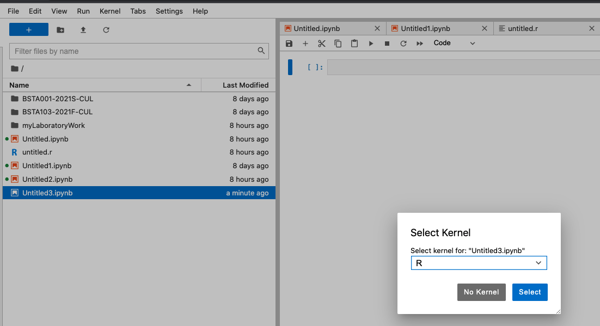

# Laboratory 01

## Jupyter Notebooks
All of our lab work will take place in Jupyter Notebooks. Jupyter Notebooks are a tool for organizing textual descriptions of work and computer programs. The goal is to produce one document to communicate a set of scientific ideas and allow another to understand exactly how you arrived at yoru conclusions.

Jupyter has some important buttons.

### File
#### A new notebook
Under file-\>New-\>Notebook you can create a new notebook. When asked to "Select Kernel" click on the drop down menu and select "R"



#### The notebook
A notebook is a collection of cells. A **cell** is a container that can hold text or computer code. Cells in Jupyter looks like gray rectangles. There are three cell types in Jupyter: (i) Code, (ii) Markdown, and (iii) Raw. The two that we will focus on are Code and Markdown.

The "Code" cell holds computer code that the R kernel (see below about a kernel) can use to compute. We may want to import data, run a statistical analysis, and output results. This is for the "Code" cell.

"Markdown" is itself a special language that a Jupyter Notebook interprets as text. The "Markdown" cell is most useful for write ups, descriptions of a Code cell above or below, or scientific conclusions, comments, and thoughts. When you need to write, think Markdown.

#### Save your work
You can always save your work, and should do so often, by clicking File -\> Save Notebook.

#### Export for submission
In class, we will ask that you submit your work on Coursesite as a **PDF**. Work in another format will not be accepted. To export your notebook as a PDF, choose File-\>Save and Export Notebook As-\>PDF

{#fig-my_label}

After you click PDF, a PDF file will be created and saved in a "Downloads" folder on your local machine. Make sure the PDF file contains (1) Your first and surname, the date, and a descriptive title.

### Kernel
The kernel is the component that executes code inside your notebook. No kernel, no running code.

Over the course, you may find that your notebook has disconnected or otherwise will no longer execute the code you wrote. Most often, the kernel has stopped. To restart you kernel select Kernel-\>Restart Kernel.

## Programming and R
The R programming language, while not explictly written for statistics, has a long history as a tool for data analysis, statistics, machine learning, and data science. R supports all of the main paradigms in computing and you will be able to transfer what you learn in R to other programming languages without much difficulty.

Programming is difficult. Like any skill, programming take time to master. Error messages will be commonplace, you will find it difficult to ask the computer to calculate what you want. You will be frustrate and that is ok. Over time you will learn to read the error messages, code will flow more easily. The most important part of programming is daily practice.

When we **execute** code, we ask the computer to translate what we wrote into binary and return a set of results that may or may not be stored in memory. In the Jupyter environment we execute code by pressing "Run" or by using the shortcut "Shift+Enter".

## Arithmetic
R supports all standard artithmetic calculations. Lets "Run" our first computation.

R can interpret addition

::: tcolorbox
``` {}
\PY{l+m}{2}\PY{l+m}{+2}
```
:::

4

Subtraction

::: tcolorbox
``` {}
\PY{l+m}{9}\PY{l+m}{\PYZhy{}3}
```
:::

6

Division

::: tcolorbox
``` {}
\PY{l+m}{3}\PY{o}{/}\PY{l+m}{4}
```
:::

0.75

multiplication

::: tcolorbox
``` {}
\PY{l+m}{4}\PY{o}{*}\PY{l+m}{4}
```
:::

16

and exponentiation

::: tcolorbox
``` {}
\PY{l+m}{3}\PY{o}{\PYZca{}}\PY{l+m}{9}
```
:::

19683

As expected, we can compute more difficult arithemetic expressions.

::: tcolorbox
``` {}
\PY{p}{(}\PY{l+m}{2}\PY{o}{\PYZca{}}\PY{l+m}{4}\PY{p}{)}\PY{l+m}{+3}\PY{o}{/}\PY{l+m}{2} \PY{o}{\PYZhy{}} \PY{l+m}{1}
```
:::

16.5

## Vectors
The **vector** is the fundemental object in R.

A mathematical vector is an ordered list of numbers. They are denoted by a sequence of numbers surrounded by square brackets.

$$\begin{aligned}
    v = \begin{bmatrix}
         1 \\
         2 \\
         3 \\
        \end{bmatrix}
\end{aligned}$$ Above, the vector **v** is a vector of length 3 and contains, in order, the values 1, 2, and 3.

In R, vectors are goven a name and stored in the computer in one of two ways: (i) using the **c()** operator or (ii) using the assign function.

### Assignment
#### c()
We can store a vector named v with the values 1,2,3 in R as follows

::: tcolorbox
``` {}
\PY{n}{v} \PY{o}{=} \PY{n+nf}{c}\PY{p}{(}\PY{l+m}{1}\PY{p}{,}\PY{l+m}{2}\PY{p}{,}\PY{l+m}{3}\PY{p}{)}
```
:::

#### assign
We can also use the assign function to store a vector, named q, with the values 3,2,1 as follows

::: tcolorbox
``` {}
\PY{n+nf}{assign}\PY{p}{(}\PY{l+s}{\PYZdq{}}\PY{l+s}{q\PYZdq{}}\PY{p}{,}\PY{n+nf}{c}\PY{p}{(}\PY{l+m}{3}\PY{p}{,}\PY{l+m}{2}\PY{p}{,}\PY{l+m}{1}\PY{p}{)}\PY{p}{)}
```
:::

#### equals
The equals sign **does not** represent two objects are equal to one another. The equals sign in compiuter programming stands for "assign".

When we write `v = c(1,2,3)`, this is understood as "we assign the variable v to the vector (1,2,3). As an example, lets create a vector `(4,5,6)` names `x` and then assign the variable `y` to be the same as `x`

::: tcolorbox
``` {}
\PY{n}{x} \PY{o}{=} \PY{n+nf}{c}\PY{p}{(}\PY{l+m}{4}\PY{p}{,}\PY{l+m}{5}\PY{p}{,}\PY{l+m}{6}\PY{p}{)}
\PY{n}{y} \PY{o}{=} \PY{n}{x}
```
:::

The last line above does not ask whether or not `x` is the same as `y`. Instead, this line assigns the variable `y` to be the same vecor as `x`.

## Print
When we created the vectors **v** and **q** "nothing happened". Though the vector v and q were created and stored in the computer, R does not display these on your screen by default. One way to view any object in R is to print it.

You can print an object, `x`, R by writing `print(x)`

::: tcolorbox
``` {}
\PY{n+nf}{print}\PY{p}{(}\PY{n}{v}\PY{p}{)}
```
:::

``` {}
[1] 1 2 3
```

::: tcolorbox
``` {}
\PY{n+nf}{print}\PY{p}{(}\PY{n}{q}\PY{p}{)}
```
:::

``` {}
[1] 3 2 1
```

::: tcolorbox
``` {}
\PY{n+nf}{print}\PY{p}{(}\PY{n}{x}\PY{p}{)}
\PY{n+nf}{print}\PY{p}{(}\PY{n}{y}\PY{p}{)}
```
:::

``` {}
[1] 4 5 6
[1] 4 5 6
```

**You do not need to print any object, ever**. Printing is not necessary. You should use print to explore whether you programmed something write or to communicate scientific results.

## Combining vectors
We can append one vector to another in R by using the c() operator. Suppose we wish to combine the two vectors $$\begin{aligned}
    x = \begin{bmatrix}
        1\\
        2\\
        3
        \end{bmatrix}; \;
    z = \begin{bmatrix}
        -1\\
        0.2\\
        90
        \end{bmatrix}
\end{aligned}$$

into one vector

$$\begin{aligned}
    r = \begin{bmatrix}
        1\\
        2\\
        3\\
        -1\\
        0.2\\
        90
        \end{bmatrix}
\end{aligned}$$

Lets first create the vectors `x` and `z`

::: tcolorbox
``` {}
\PY{n}{x} \PY{o}{=} \PY{n+nf}{c}\PY{p}{(}\PY{l+m}{1}\PY{p}{,}\PY{l+m}{2}\PY{p}{,}\PY{l+m}{3}\PY{p}{)}
\PY{n}{z} \PY{o}{=} \PY{n+nf}{c}\PY{p}{(}\PY{l+m}{\PYZhy{}1}\PY{p}{,}\PY{l+m}{0.2}\PY{p}{,}\PY{l+m}{90}\PY{p}{)}
```
:::

Now we can create the vector `r`

::: tcolorbox
``` {}
\PY{n}{r} \PY{o}{=} \PY{n+nf}{c}\PY{p}{(}\PY{n}{x}\PY{p}{,}\PY{n}{z}\PY{p}{)}
```
:::

If we want to check our work, we can print out `r`.

::: tcolorbox
``` {}
\PY{n+nf}{print}\PY{p}{(}\PY{n}{r}\PY{p}{)}
```
:::

``` {}
[1]  1.0  2.0  3.0 -1.0  0.2 90.0
```

## Indexing and access
Vectors are useful for storing several different numbers. We can access single elements, or several elements inside a vector by (i) naming the vector we want to access, (ii) typing square brackets "\[\]".

### Numeric indexing
If we want to access the 4th element in `r`, we can type

::: tcolorbox
``` {}
\PY{n}{r}\PY{p}{[}\PY{l+m}{4}\PY{p}{]}
```
:::

-1

If we want to access, the 2nd, 4th, and then the first element of `r` we can include in square brackets the vector `c(2,4,1)`

::: tcolorbox
``` {}
\PY{n}{r}\PY{p}{[}\PY{n+nf}{c}\PY{p}{(}\PY{l+m}{2}\PY{p}{,}\PY{l+m}{4}\PY{p}{,}\PY{l+m}{1}\PY{p}{)}\PY{p}{]}
```
:::

::: enumerate*
2

-1

1
:::

We can access the 1st,2nd, and 3rd elements in `r` using the vector `c(1,2,3)`, however a shortcut is to use the **colon** operator. The colon operator takes as input two integers (a,b) separated by a colon (a:b) and expands to the vector `c(a,a+1,a+2,a+3,...,b)`.

Watch

::: tcolorbox
``` {}
\PY{n}{z} \PY{o}{=} \PY{l+m}{3}\PY{o}{:}\PY{l+m}{5}
```
:::

::: tcolorbox
``` {}
\PY{n+nf}{print}\PY{p}{(}\PY{n}{z}\PY{p}{)}
```
:::

``` {}
[1] 3 4 5
```

The colon operator is useful for accessing items in a vector

::: tcolorbox
``` {}
\PY{n}{r}\PY{p}{[}\PY{l+m}{2}\PY{o}{:}\PY{l+m}{5}\PY{p}{]}
```
:::

::: enumerate*
2

3

-1

0.2
:::

The above is called **numeric indexing**. Numeric indexing is the access of elements in an object (here a vector) by inputting a single number, or vector of numbers. Indices are always integers. Fractional or decimal numbers cannot be used as indices. Up until now we only used *positive* integers to access elements of a vector.

R also accepts negative integers as indices. Warning: R handles negative indices different than the majority of other progamming languages. A negative index in R standard for **exclude**.

For example, if we want to return all the elements of a vector `q = c(1,4,6,10,0.5)` except for the 2nd element, we can write `q``[``-2``]`

::: tcolorbox
``` {}
\PY{n}{q} \PY{o}{=} \PY{n+nf}{c}\PY{p}{(}\PY{l+m}{1}\PY{p}{,}\PY{l+m}{4}\PY{p}{,}\PY{l+m}{6}\PY{p}{,}\PY{l+m}{10}\PY{p}{,}\PY{l+m}{0.5}\PY{p}{)}
\PY{n}{q}\PY{p}{[}\PY{l+m}{\PYZhy{}2}\PY{p}{]}
```
:::

::: enumerate*
1

6

10

0.5
:::

### Logical vectors and logical indexing
#### True and False
R, like all programming languages, understands how to operate with binary logic (aside: binary logic is not the only type. If interested, google the tetralemma). True in R is represeted as the word `TRUE` in all capitals. False in R is represented as the word `FALSE` in all capitals. The symbols `TRUE` and `FALSE` are reserved, special symbols in R. You cannot assign a variable to `TRUE` or `FALSE`.

::: tcolorbox
``` {}
\PY{k+kc}{TRUE}
```
:::

TRUE

::: tcolorbox
``` {}
\PY{k+kc}{FALSE}
```
:::

FALSE

#### Logical comparisons
R understand the following logical operators: - `>` "Greater than" - `>=` "Greater than or equal to" - `<` "Less than" - `<=` "Less than or equal to" - `==` "Is equal to" - `!=` "Not equal" - "OR" - `&` "AND"

#### Logic
Logic is a method to evaluate statements, sometimes called propositions as either True or False. The above symbols are used to evaluate statements.

When you pose a proposition to R, such as `v > -1` R will evaluate that propositon for each individual element in the vector `v`. Lets create the vector `v = c(-10,10,4)` and ask R to evaluate the proposition `v>-1`.

::: tcolorbox
``` {}
\PY{n}{v} \PY{o}{=} \PY{n+nf}{c}\PY{p}{(}\PY{l+m}{\PYZhy{}10}\PY{p}{,}\PY{l+m}{10}\PY{p}{,}\PY{l+m}{4}\PY{p}{)}
\PY{n}{v} \PY{o}{\PYZgt{}} \PY{l+m}{\PYZhy{}1}
```
:::

::: enumerate*
FALSE

TRUE

TRUE
:::

We see that R returns a vector with the same numebr of elements as in v containing the values TRUE or FALSE. A vector that contains values TRUE/FALSE is called a **logical vector**. Like any other vector we can store a logical vector.

::: tcolorbox
``` {}
\PY{n}{log} \PY{o}{=} \PY{n}{v}\PY{o}{\PYZgt{}}\PY{l+m}{\PYZhy{}1}
```
:::

::: tcolorbox
``` {}
\PY{n+nf}{print}\PY{p}{(}\PY{n}{log}\PY{p}{)}
```
:::

``` {}
[1] FALSE  TRUE  TRUE
```

#### AND, OR, and NOT
AND, OR, and NOT are **logical operators**, they allow us to combine one or more propositions. Given two propositions $p_{1}$ and $p_{2}$, the AND, OR, and NOT operator will evaluate to the following

::: {#tab-my_label}
   $p_{1}$   $p_{2}$   $p_{1}$ AND $p_{2}$   $p_{1}$ OR $p_{2}$   !$p_{1}$
  --------- --------- --------------------- -------------------- ----------
    TRUE      TRUE            TRUE                  TRUE           FALSE
    TRUE      FALSE           FALSE                 TRUE           FALSE
    FALSE     TRUE            FALSE                 TRUE            TRUE
    FALSE     FALSE           FALSE                FALSE            TRUE

  : Caption
:::

Logical operators come in handy in **logical indexing**. When we write `r``[``l``]` where `l` is a logical vector, R will return the the values in `r` where `l` is TRUE.

::: tcolorbox
``` {}
\PY{n}{r} \PY{o}{=} \PY{n+nf}{c}\PY{p}{(}\PY{l+m}{\PYZhy{}10}\PY{p}{,}\PY{l+m}{0}\PY{p}{,}\PY{l+m}{10}\PY{p}{,}\PY{l+m}{55}\PY{p}{,}\PY{l+m}{0.34}\PY{p}{,}\PY{l+m}{\PYZhy{}0.97}\PY{p}{)}
\PY{n}{l} \PY{o}{=} \PY{n+nf}{c}\PY{p}{(}\PY{k+kc}{TRUE}\PY{p}{,}\PY{k+kc}{FALSE}\PY{p}{,}\PY{k+kc}{TRUE}\PY{p}{,}\PY{k+kc}{FALSE}\PY{p}{,}\PY{k+kc}{TRUE}\PY{p}{,}\PY{k+kc}{TRUE}\PY{p}{)}

\PY{n}{r}\PY{p}{[}\PY{n}{l}\PY{p}{]}
```
:::

::: enumerate*
-10

10

0.34

-0.97
:::

More often we will include the logical statement directly inside the square brackets

::: tcolorbox
``` {}
\PY{n}{r}\PY{p}{[} \PY{n}{r}\PY{o}{\PYZgt{}}\PY{l+m}{0} \PY{p}{]}
```
:::

::: enumerate*
10

55

0.34
:::

#### Equivalence of TRUE and FALSE to 1 and 0
The symbol `TRUE` in R is understood to be the same as the value `1`, and the symbol `FALSE` in R is understood to be the same value as `0`.

::: tcolorbox
``` {}
\PY{k+kc}{TRUE}\PY{o}{==}\PY{l+m}{1}
```
:::

TRUE

::: tcolorbox
``` {}
\PY{k+kc}{FALSE}\PY{o}{==}\PY{l+m}{0}
```
:::

TRUE

::: tcolorbox
``` {}
\PY{k+kc}{TRUE}\PY{o}{==}\PY{l+m}{0}
```
:::

FALSE

::: tcolorbox
``` {}
\PY{k+kc}{FALSE}\PY{o}{==}\PY{l+m}{1}
```
:::

FALSE

### Two functions that are useul for operating on vectors
Functions in mathematics take as input a list of objects and return a unique object. The same is true of functions in programming and so in R.

We can create our own functions in R (this will come later), but R also has a large library of built-in functions that are automatically included once you start R. Two very sueful ones are the `sum` function and the `length` function.

The `sum` function takes as input a vector and returns the sum of each element in the function.

::: tcolorbox
``` {}
\PY{n}{v} \PY{o}{=} \PY{n+nf}{c}\PY{p}{(}\PY{l+m}{3}\PY{p}{,}\PY{l+m}{2}\PY{p}{,}\PY{l+m}{1}\PY{p}{)}
\PY{n+nf}{sum}\PY{p}{(}\PY{n}{v}\PY{p}{)}
```
:::

6

The `length` function takes as input a vector and returns the number of elements in the vector

::: tcolorbox
``` {}
\PY{n+nf}{length}\PY{p}{(}\PY{n}{v}\PY{p}{)}
```
:::

3

## Assignment 01
We are recruited to track the evolution of an infectious agent for a team of public health officials (PHOs). To support future strategic planning the PHOs want to know the impact of intervention $X$ on increases or decreases in the incidence of this infectious agent. The PHO team collected for each county in their state whether the intervention was enacted, and whether the incidence of case counts of this infectious agent increased or decreased 60 days after the intervention was in place data.

Using R, we will assign probabiltiies to the four events in our sample space { (intervention,raise),(intervention, no raise),(no intervention, raise),(no intervention, no raise) }

### The data
In the below cell there is a few lines of code pre-programmed. Please runs this cell below.

This cell will create two vectors.

The first vector is called `intervention_rise` and contains one element for each county that has intervention $X$ collected by the PHO team. An element is the value `1` if there was a rise in incidence for the infectious agent and `0` if there was a fall in incidence.

The second vector is called `nointervention_rise` and contains one element for each county that did not have intervention $X$ collected by the PHO team. An element is the value `1` if there was a rise in incidence for the infectious agent and `0` if there was a fall in incidence.

### Please complete the following
1.  Use the `length` function to count the number of counties where intervention $X$ took place

2.  Use the `length` function to count the number of counties where no intervention $X$ took place

3.  Use the `sum` function to count the number of counties that observed a rise in incidence.

4.  Use the `sum` function and the `not (!)` operator to count the number of counties that observed a fall in incidence.

5.  Use the frequentist approach to compute the probability

    - that an intervention would take place in a county

    - that a rise in incidence was observed in a county

    - of a rise in incidence given a county implemented intervention $X$

    - of a rise in incidence given a county has not implemented intervention $X$

6.  Use the multiplication rule to compute the probability

    - that an intervention and rise is observed (Hint: P(Intervention) \* P(RiseIntervention))

    - that an intervention and fall is observed

    - that no intervention and rise is observed

    - that no intervention and fall is observed

7.  Compute the probability of the below events, assuming intervention and rise/fall. are independent

    - Intervention and Rise

    - Intervention and Fall

    - No Intervention and Rise\

    - No Intervention and Fall

8.  Do you think intervention $X$ is effective at preventing the spread of our infectious agent?

::: tcolorbox
``` {}
\PY{c+c1}{\PYZsh{}RUN THIS CODE. DO NOT WORRY WHAT IT SAYS. }
\PY{n}{nums} \PY{o}{=} \PY{n+nf}{runif}\PY{p}{(}\PY{l+m}{10}\PY{o}{\PYZca{}}\PY{l+m}{3}\PY{p}{,}\PY{l+m}{0}\PY{p}{,}\PY{l+m}{1}\PY{p}{)}

\PY{n}{intervention\PYZus{}rise}   \PY{o}{=} \PY{n+nf}{c}\PY{p}{(}\PY{p}{)}
\PY{n}{nointervention\PYZus{}rise} \PY{o}{=} \PY{n+nf}{c}\PY{p}{(}\PY{p}{)}
\PY{n+nf}{for }\PY{p}{(}\PY{n}{i} \PY{n}{in} \PY{n}{nums}\PY{p}{)}\PY{p}{\PYZob{}}
    \PY{n+nf}{if }\PY{p}{(}\PY{n+nf}{runif}\PY{p}{(}\PY{l+m}{1}\PY{p}{)}\PY{o}{\PYZgt{}} \PY{l+m}{0.4}\PY{p}{)}\PY{p}{\PYZob{}}
        \PY{n+nf}{if }\PY{p}{(} \PY{n}{i}\PY{o}{\PYZgt{}}\PY{l+m}{0.800} \PY{p}{)}\PY{p}{\PYZob{}}
          \PY{n}{risefall} \PY{o}{=} \PY{l+m}{1}   
        \PY{p}{\PYZcb{}} \PY{n}{else}\PY{p}{\PYZob{}}\PY{n}{risefall}\PY{o}{=}\PY{l+m}{0}\PY{p}{\PYZcb{}}
        \PY{n}{intervention\PYZus{}rise} \PY{o}{=} \PY{n+nf}{c}\PY{p}{(}\PY{n}{intervention\PYZus{}rise}\PY{p}{,} \PY{n}{risefall}\PY{p}{)}
    \PY{p}{\PYZcb{}}
    \PY{n}{else} \PY{p}{\PYZob{}}
        \PY{n+nf}{if }\PY{p}{(} \PY{n}{i}\PY{o}{\PYZgt{}}\PY{l+m}{0.325} \PY{p}{)}\PY{p}{\PYZob{}}
          \PY{n}{risefall} \PY{o}{=} \PY{l+m}{1}   
        \PY{p}{\PYZcb{}} \PY{n}{else}\PY{p}{\PYZob{}}\PY{n}{risefall}\PY{o}{=}\PY{l+m}{0}\PY{p}{\PYZcb{}}
        \PY{n}{nointervention\PYZus{}rise} \PY{o}{=} \PY{n+nf}{c}\PY{p}{(}\PY{n}{nointervention\PYZus{}rise}\PY{p}{,} \PY{n}{risefall}\PY{p}{)}
    \PY{p}{\PYZcb{}}
\PY{p}{\PYZcb{}}
```
:::
